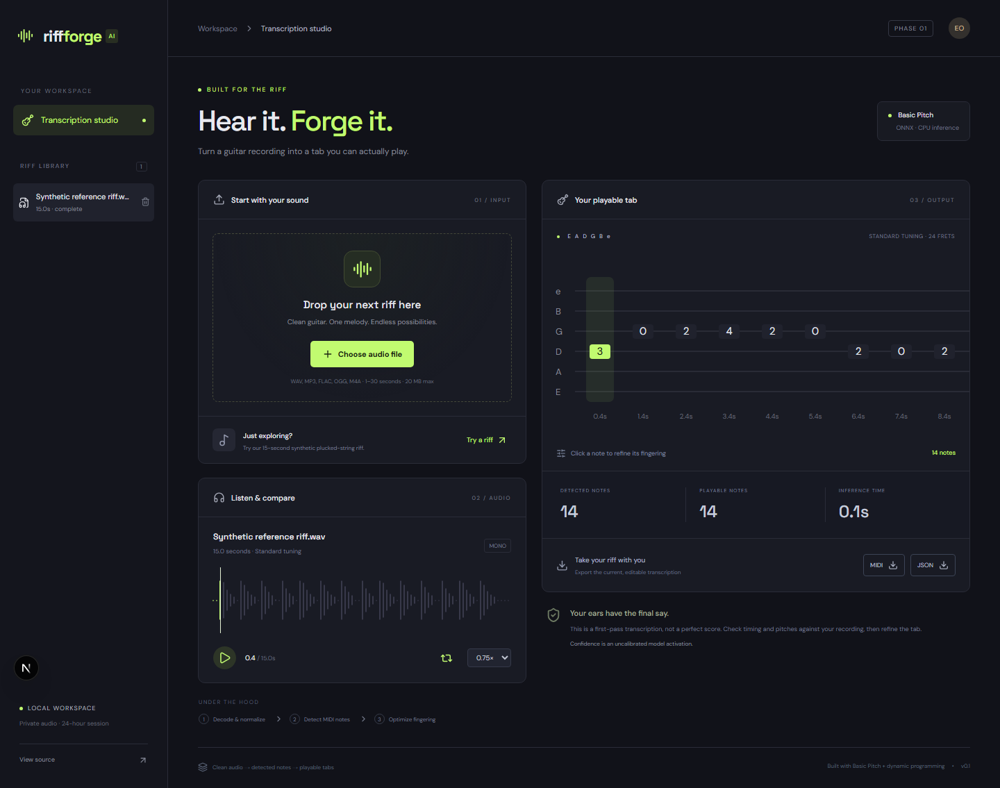
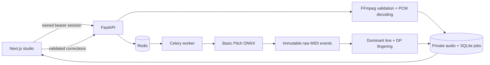

# RiffForge AI

[](https://github.com/Emad0b/riffforge-ai/actions/workflows/ci.yml)

**Hear it. Forge it.** A working audio-to-guitar-tab studio with real neural transcription, globally optimized fingerings, synchronized playback, and editable results.



## Try the first milestone

```bash
docker compose up --build -d --wait
```

Open **http://localhost:5178**, select **Try a riff**, and wait for the background worker. Play the original audio, slow it down, click a tab note to correct its fingering or pitch, then export MIDI or JSON. You can also upload a clean 1–30 second guitar recording (20 MB maximum).

The included 15-second demo is a **self-authored synthetic plucked-string signal**, not a recorded electric guitar. Its reference labels are used only in evaluation; the application always runs Basic Pitch on the audio. No cached result is substituted for inference.

## What is implemented

- FastAPI API and Next.js/TypeScript transcription studio.
- Signature checking, bounded FFmpeg decoding, mono 22,050 Hz conversion, decoded-duration validation, and private local file handling.
- Spotify Basic Pitch 0.4.0's bundled **ONNX model**, using CPU inference with model SHA-256 provenance.
- Standard-tuning pitch mapping across six strings and 24 frets. A dynamic-programming solver minimizes movement across the entire monophonic phrase.
- Redis/Celery background processing in Docker; a separate durable SQLite polling worker for development without Docker. Transactional claims, recovery leases, and periodic reconciliation handle worker interruption or missed broker delivery.
- WaveSurfer waveform playback, full-clip looping, speed control, current-note highlighting, and click-to-seek.
- Editable string/fret and pitch assignments, optimistic concurrency, preserved original predictions, MIDI and JSON exports.
- Session ownership checks on every transcription, audio, edit, deletion and export route. Automatic 24-hour retention cleanup while a worker runs.
- Real-model regression evaluation, exhaustive fingering optimality checks, security tests, browser tests, and a Docker integration check.

## Measured evidence

The committed [evaluation report](docs/evaluation.json) records 14 reference notes, 14 detected notes, **1.00 onset F1** and **1.00 onset+offset F1**, using mir_eval's 50 ms onset tolerance, 50 cent pitch tolerance, and offset tolerance of max(50 ms, 20% of the reference duration). One local warm run took 2.737 seconds; timings vary by machine and cold-start compilation.

This is a **single synthetic smoke test**, not an estimate of real-world guitar accuracy, latency percentiles, or confidence calibration. CI reruns the actual model and uploads fresh evaluation evidence. Raw activations are not probabilities.

```bash
python -m riffforge.evaluate
python -m pytest -q
```

## Run without Docker

Python **3.12** and Node.js **22** are the tested runtimes.

```bash
python -m venv .venv
# Linux/macOS: source .venv/bin/activate
# Windows PowerShell: .venv\Scripts\Activate.ps1
pip install -r requirements.txt
pip install --no-deps basic-pitch==0.4.0
python -m uvicorn riffforge.api:app --host 127.0.0.1 --port 8400
```

In a second terminal, activate the same environment and run:

```bash
python -m riffforge.worker
```

In a third terminal:

```bash
cd apps/web
npm ci
npm run dev
```

Basic Pitch's upstream installer chooses an older TensorFlow range for recent Python versions. This project deliberately installs the package without automatic dependencies and provides its required audio libraries and ONNX runtime explicitly. `setuptools<81` is necessary for resampy's existing `pkg_resources` use. The Python 3.12 ONNX profile is verified by this repository's CI; upstream documentation lists a narrower Python support range.

To run browser tests, start both backend processes and the frontend, then run `npx playwright install chromium` and `npm test` from `apps/web`.

## Architecture



The database is the source of truth. Broker delivery starts processing promptly; Celery Beat reconciles queued or expired leased work. Local development substitutes a polling worker, not a fake Redis service. SQLite and local object files are shared only on one host; this phase is not a horizontally scaled storage architecture.

```text
riffforge/        API, decoder, model adapter, fingering, worker, evaluation
apps/web/        Next.js studio + browser regression tests
tests/fixtures/  Licensed synthetic audio and reference events
docs/            Architecture, model card, security and measured evidence
.github/         CPU-model, security, browser and Docker CI
```

API documentation: **http://localhost:8400/docs**. `POST /api/session` issues a temporary workspace token; upload with `POST /api/transcriptions`, inspect `/api/transcriptions/{id}`, fetch private `/audio`, save corrections with `PATCH`, export `/export/json` or `/export/mid`, and delete with `DELETE`.

## Phase 1 boundaries

The intended input is a clean, single-line guitar riff in standard tuning. Raw overlapping predictions are preserved, while the playable tab selects a dominant monophonic line. It does not claim to solve chords, bends, slides, alternate tuning, multiple guitars or full mixes. Note timing is displayed directly in seconds; SVG tab rendering avoids inventing quantized rhythms. AlphaTab score notation, beat quantization, Demucs separation, PostgreSQL/S3 migration, authenticated accounts, tracing and model release gates belong to later phases.

The current bearer sessions and loopback-only Docker ports are appropriate for a local portfolio demonstration. Review [security](docs/security.md) before any public service deployment. No hosted production URL is implied by publishing the source.

Read the [architecture](docs/architecture.md), [model card](docs/model-card.md), and [security notes](docs/security.md).

## Attribution and license

Project code and self-authored fixtures: [MIT](LICENSE). Basic Pitch model and package: [Spotify Basic Pitch](https://github.com/spotify/basic-pitch), Apache-2.0. Other dependencies retain their own licenses; model weights and FFmpeg binaries are installed as dependencies rather than committed. Waveform playback uses [WaveSurfer](https://wavesurfer.xyz/docs/); evaluation uses [mir_eval](https://craffel.github.io/mir_eval/).
